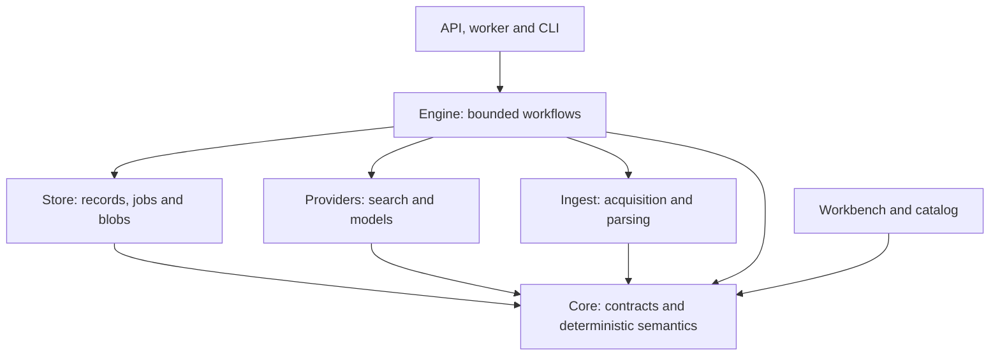

# Architecture and evidence lifecycle

The normative specification is [specs/00_engine.md](../specs/00_engine.md); executable contracts live in `packages/*/src/contract.ts`. This document explains the choices behind them.

## Dependency direction

Sites import the browser-safe `@deeplake/core/contract` entry point. They cannot import storage, acquisition, provider or engine implementations. Architecture tests enforce dependency direction and reject known fixture-domain leakage in packages. Domain knowledge belongs in project configuration, a generated schema, fixtures or site configuration.

## Four separate kinds of state

1. **Evidence:** source URLs, immutable byte versions, parser outputs and record segments. A failed reprocessing attempt cannot erase these.
2. **Interpretation:** entities, scoped field observations, model/parser/schema identities and audits. A new interpretation adds history.
3. **Decisions:** proposed schemas, approval/rejection reasons, breaking-change acknowledgement and jobs. A proposal is not an approved schema.
4. **Publication:** an immutable projection and a mutable project pointer to the selected release. Publishing and rollback are explicit.

A source's `latestVersionId` determines current source evidence. A publication pins its schema and all source-version references. A later fetch or interpretation does not mutate an earlier release.

## Discovery and interpretation

The operator supplies a bounded topic and questions the result must answer. The planner produces query objectives, source families and exploratory queries. Search returns candidate URLs, not factual answers. Seed URLs and known collections enter the same bounded frontier.

Acquisition validates public network addresses, pins DNS answers, checks robots rules and bounds redirects, bytes and time. Original bytes are content addressed. A parser returns text, quality warnings, structural segments, context and page metadata. Repeated records must remain distinct before extraction; individually exact field spans alone cannot prove that fields describe the same record.

Schema bootstrap sees diverse source samples and the answerability questions. The schema defines entity types, identity fields, applicability scope, field kinds, units, constraints and structured shapes. The engine compiles separate extraction work for each record and type. JSON mappings can use deterministic extraction. Scalar evidence uses Clairic; structured representations use the explicitly identified reasoning path. Every returned payload is validated.

The representation audit sees source text and schema before it sees extracted observations. This prevents the extracted table from defining everything an audit is allowed to notice. The subsequent extraction audit receives observations and checks them against evidence. Findings belong to five classes: acquisition, extraction, schema gap, identity/scope and disagreement.

## Publication gate

Publication validates project/schema/source relationships, supported status, exact quotations and offsets, field types, entity identity and scope. The current schema determines visible fields. Source freshness is determined by the stored current-version pointer, not by whichever observation arrived last. Numeric extraction also checks that the value is present in its quoted passage.

The gate does not turn unknowns into zero, missing text into a negative assertion, a recommendation into a requirement, or an estimate into an asserted fact. A structured or derived value without sufficient provenance remains withheld. Conflicting supported alternatives remain visible with a null selected value. An old schema's observations cannot silently satisfy a newly introduced field.

This is a conservative evidence gate, not a theorem prover. A semantic mistake can still occur when a source is ambiguous or an extractor and auditor misunderstand the same prose. The Gauntlet suite therefore attacks binding, scope and unsupported publication in addition to checking types.

## Evolution, replay and reparse

A schema proposal is based on a current version, a compatibility diff, evidence and a rationale. Approval validates the candidate, rejects stale bases, requires explicit permission for breaking changes, records the decision and enqueues replay atomically. It never publishes.

**Replay** interprets preserved parser segments using the current approved schema. It is the right operation after a schema or model-protocol change.

**Reparse** reads preserved original bytes using the current parser. It creates new immutable parsed versions and then interprets usable segments. Omitted IDs select current sources only; explicitly reparsing history cannot move the latest pointer backward. Unusable results and failures keep the prior current version. Parser version and effective output-affecting options are part of immutable version identity.

**Maintenance** uses conditional fetch headers and content hashes to avoid unnecessary work, while changed bytes create new evidence versions. These three operations have different meanings and separate durable job kinds.

## Durability and retries

Both local and production stores execute the same migrations. PGlite supplies a single-process local PostgreSQL runtime. A process lock prevents the CLI and API from simultaneously owning one local directory. Production uses PostgreSQL and a bounded connection pool.

Jobs have idempotency keys, bounded attempts, availability timestamps, lease owners, random fencing tokens and expirations. Claims use `FOR UPDATE SKIP LOCKED`. An expired worker cannot heartbeat or complete a replacement worker's job. A cancelled lease is invalid immediately. The worker checks ownership through long operations; deterministic evidence IDs make repeated writes idempotent.

Serializable internal database operations retry complete transactions after serialization/deadlock conflicts. Arbitrary `Repository.transaction` callbacks are not automatically rerun because they may contain external side effects. The caller must retry those transitions against fresh state. A queue fence cannot cancel a provider request that already reached the provider; unknown remote outcomes remain an operational cost limitation.

Budget reservations are transactional and run-scoped. Costs are reconciled to reported usage when available; estimated cost and provider identity remain visible. This prevents internal oversubscription without pretending to guarantee vendor billing.

## Public and operator data

`WorkspaceSnapshot` is an authenticated operator read model containing source artifacts, findings, jobs, proposed schemas and usage. It is never a public catalog input.

`PublicDataset` contains only the selected release, its approved schema, minimal project metadata, contributing source metadata and parsed passages cited by the publication. `buildPublicDataset` revalidates source relationships and exact spans, refuses missing context and strips private metadata; unrelated segments are excluded. Source context is shown as a document's statement, not as additional asserted facts. Catalog imports validate the same boundary. Browser credentials are session-local; server provider keys never enter static bundles. The demo exporter refuses live project snapshots.

## External design references

- [W3C PROV-DM](https://www.w3.org/TR/prov-dm/) supplies the external provenance vocabulary and traceability bar.
- [Temporal workflow execution](https://docs.temporal.io/workflow-execution) supplies the replay/durability bar; this project implements its own bounded PostgreSQL queue, not Temporal's complete execution model.
- [Cloudflare Clairic](https://developers.cloudflare.com/workers-ai/models/clairic/) documents the scalar extraction interface and evidence behavior.
- [Exa Search](https://docs.exa.ai/reference/search) and [Contents](https://docs.exa.ai/reference/get-contents) document the URL-discovery and source-text interfaces.
- [Next.js static exports](https://nextjs.org/docs/app/guides/static-exports) define the deployment model for both sites.

Provider contracts are tested at the HTTP boundary with controlled responses. Their live performance and the factual correctness of a source require separate measurement.
